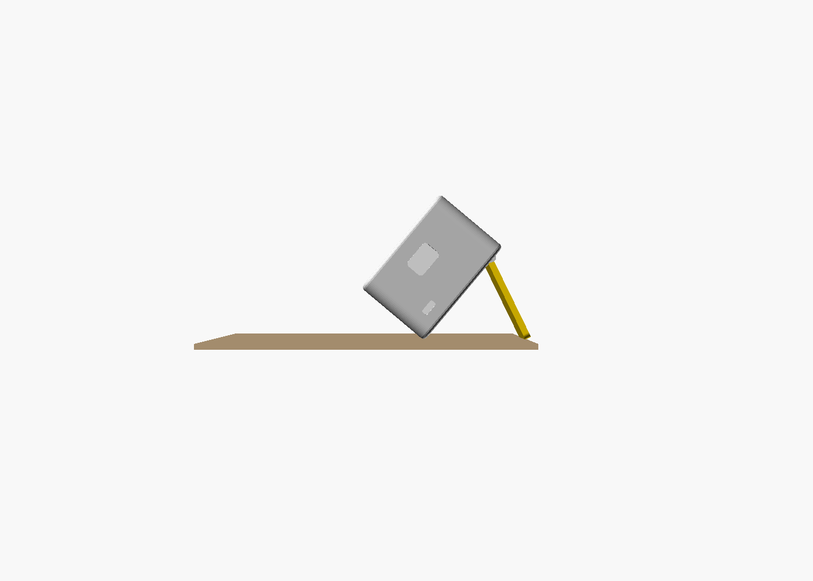
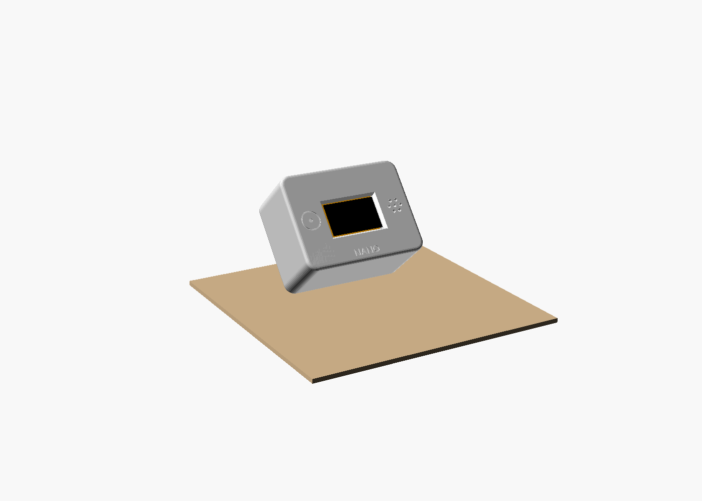
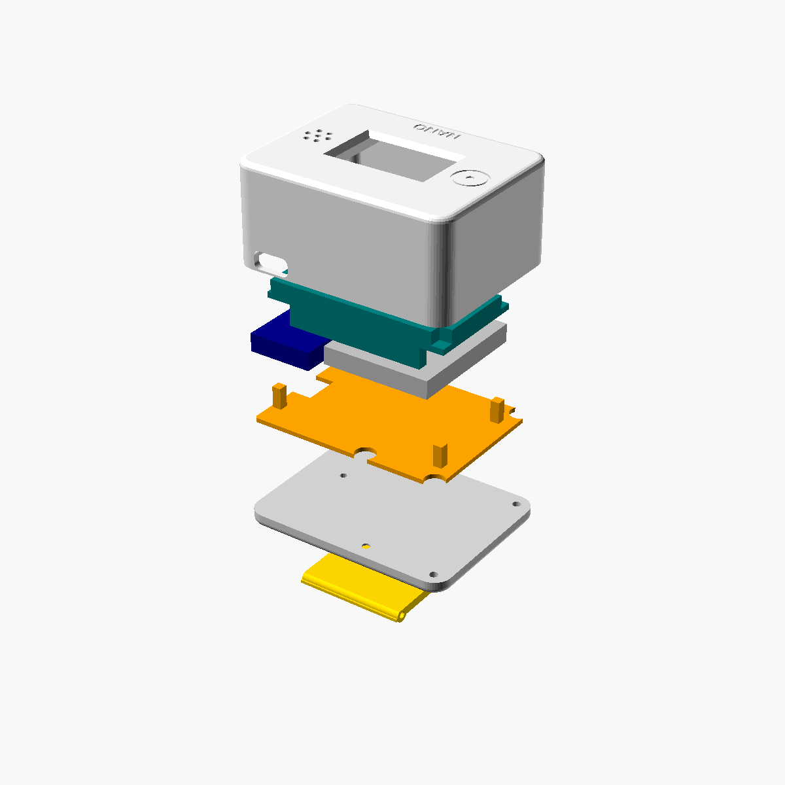

# Nano pocket case

A 3D-printed case for Nano that fits in a pocket and stands on a desk. It has a built-in battery and a fold-out kickstand.
Designed for the ESP32 DevKit V1 (30 pins), with wires soldered directly to the pins (no jumper wires).

**Outside size:** 59.6 × 45.6 × 30.6 mm (plus a 1.2 mm hinge bump on the back)

| Standing on the kickstand | Front | Exploded |
|---|---|---|
|  |  |  |

From the front: touch spot on the left, screen in the middle, speaker grille on the right.
The ESP32's micro-USB (for uploading) and the on/off switch are on the right side. The USB-C charging port is on the top, so you can charge it while it stands.

## Files to print (`stl/`)

| File | Print it like this |
|---|---|
| `nano_shell.stl` | front face down |
| `nano_lid.stl` | flat side down, hinge bumps up |
| `nano_plate.stl` | pegs up |
| `nano_kickstand.stl` | flat |

**For the print shop:** PETG (or PLA), 0.2 mm layers, 3 walls/perimeters, 20–25% infill, **no supports**, scale 100%. All four parts together are about 33 g.

`nano_case.scad` is the source (free [OpenSCAD](https://openscad.org)). Every size is a parameter at the top of the file.

## Parts to buy

| Part | Notes |
|---|---|
| LiPo battery **503035** (3.7 V, 500 mAh, 30 × 35 × 5 mm) | with a protection board and 2 wires |
| **TP4056 USB-C charger board with protection** (6 pads: IN+, IN−, B+, B−, OUT+, OUT−), 28 × 17.5 mm | the version *with* OUT+/OUT− |
| **SS12D00** mini slide switch (8.6 × 3.6 mm) | on/off |
| 4 × **M2 × 10 mm** screws | self-tapping or normal |
| 42 mm of **1.75 mm 3D-printer filament** | hinge pin (ask the print shop for a piece) |
| Thin silicone wire, 26–30 AWG | about 1 m in total |
| 220 Ω resistor (recommended) | in series with the buzzer |
| Double-sided foam tape and/or hot glue | holds the parts in place |

You already have the ESP32 DevKit V1, the 0.96" OLED, the TTP223 and the KC1206 buzzer.

## Wiring

```
OLED      VCC -> 3V3     GND -> GND     SDA -> P21     SCL/SCK -> P22
TTP223    VCC -> 3V3     GND -> GND     I/O -> P4
Buzzer    +   -> 220 ohm -> P25         -   -> GND
Battery   +   -> TP4056 B+              -   -> TP4056 B-
TP4056    OUT+ -> switch (middle pin), switch (side pin) -> ESP32 VIN
          OUT- -> ESP32 GND
```

* Turn the switch **off** before plugging the ESP32's micro-USB in to upload firmware.
* Charge through the USB-C on top. The charge LED shows through the small hole in the lid.
* Expect about 4–5 hours of use per charge. The ESP32 runs straight from the LiPo via VIN, so it may reset when the battery is nearly empty. Just charge it.

## Assembly

1. **Prepare the parts.** Solder 6–8 cm wires to the OLED's 4 holes from the back, to the TTP223's 3 pads, and to the buzzer. Bend the buzzer's legs flat against its back first.
2. **Front layer.** Lay the shell face down. Press in the OLED (glass toward the window), the buzzer (into the ring behind the grille) and the TTP223 (into the small frame behind the touch circle, with the flat touch-pad side toward the front). Hold each one with a dab of hot glue or foam tape.
3. **ESP32.** Trim the ESP32's header pins to about 2 mm, then solder the wires to them (see Wiring). Lay the ESP32 in with **the metal module facing the screen**: the micro-USB goes into the side opening and the antenna end rests on the two small posts. Route the wires around the board's top and bottom edges.
4. **Battery plate.** Put it on with the 4 pegs down. They press on the ESP32's corners.
5. **Power layer.** Glue the switch behind its slot. Put the TP4056 in the top corner beside it, with the USB-C pushed into the top opening and its LEDs facing the lid. Stick the battery on the plate with foam tape. Feed the VIN/GND wires through the notch in the plate.
6. **Lid.** Screw it on with the 4 M2 screws.
7. **Kickstand.** Line up its hinge with the knuckles on the lid and push the 1.75 mm filament pin through. Trim the pin and put a drop of glue on each end.

Fold the kickstand out with the notch at its bottom. It stops at about 66°, and Nano leans back at about 40° (the screen faces up at 50°). With the kickstand folded, Nano also stands upright on its bottom.

## If your parts are a different size

Measure your parts before printing, especially if any differ from the sizes below. Change the numbers at the top of `nano_case.scad`, then export again (File > Export > STL, with `part = "shell"` and so on).

| Parameter | Default | What it is |
|---|---|---|
| `esp_l`, `esp_w` | 51.5 × 28.4 | ESP32 board |
| `esp_under` | 6.0 | header plastic + trimmed pins + wires under the ESP32 |
| `oled_w`, `oled_h` | 27.3 × 27.8 | OLED board |
| `oled_win_dy` | -1.0 | moves the window up/down over the visible screen area |
| `buz_d`, `buz_h` | 12 × 6 | buzzer |
| `bat_w`, `bat_l`, `bat_t` | 30 × 35 × 5 | battery |

The `check_*` views are collision tests and should render as empty objects. `check_leg_stop` should *not* be empty; that is the kickstand stop.

---
Developed by Mohamed Thahir — https://github.com/thahirsprojects
